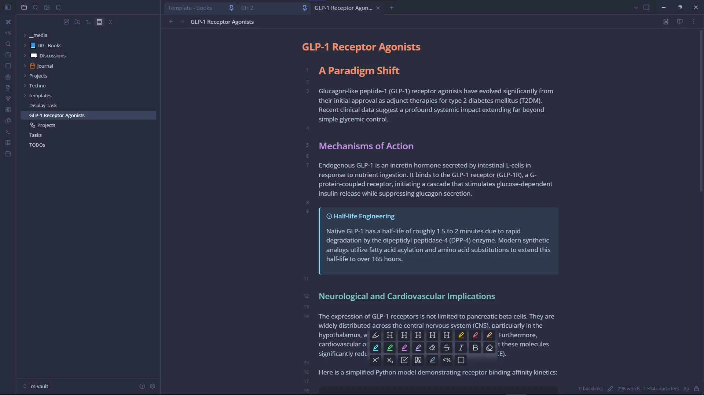

# Obsidian Palenight Plus Theme


*Obsidian Palenight Plus by KNY00*

A polished and modern theme for [Obsidian](https://obsidian.md/), faithfully inspired by the color palette of the renowned VS Code **Material Palenight** theme created by Olaolu Olawuyi.

---

## 🎨 Color Palette (Palenight)

| Role | Description | Hex |
| :--- | :--- | :--- |
| **Primary Background** | Deep midnight blue | `#292D3E` |
| **Secondary Backgrounds / Sidebars** | Dark shades | `#282C3D` / `#232635` |
| **Primary Text** | Soft pearl grey | `#BFC7D5` |
| **Contrasting Text / Headings** | Crisp bluish white | `#EEFFFF` |
| **Signature Accent / Buttons / Caret** | Palenight purple | `#7E57C2` |
| **H1 & Numbers** | Peach / Orange | `#F78C6C` |
| **H2 & Keywords** | Lilac / Purple | `#C792EA` |
| **H3 & Tags / Properties** | Turquoise / Teal | `#80CBC4` |
| **H4 & Variables / Classes** | Amber yellow | `#FFCB6B` |
| **H5 & Functions** | Sky blue | `#82AAFF` |
| **H6 & Strings** | Tender green | `#C3E88D` |
| **Errors & Critical Warnings** | Coral red | `#FF5370` |

---

## 🏗️ Project Architecture (7-1 SCSS Pattern)

The project follows the standard **7-1 architecture pattern**, ensuring optimal modularity, maintainability, and scalability:

```text
obsidian-theme/
├── manifest.json              # Obsidian theme metadata
├── package.json               # Build scripts & dependencies
├── versions.json              # Version release compatibility map
├── version-bump.mjs           # Version bump synchronization script
├── theme.css                  # Compiled theme output loaded by Obsidian
└── src/
    └── scss/
        ├── abstracts/         # Variables, tokens, mixins, functions, utilities
        │   ├── _variables.scss
        │   ├── _functions.scss
        │   ├── _mixins.scss
        │   ├── _utilities.scss
        │   └── _index.scss
        ├── base/              # Global styles, Markdown typography, :root variables
        │   ├── _reset.scss
        │   ├── _root.scss
        │   ├── _typography.scss
        │   └── _index.scss
        ├── components/        # Component modules (BEM methodology)
        │   ├── _buttons.scss
        │   ├── _inputs.scss
        │   ├── _modals.scss
        │   ├── _callouts.scss
        │   ├── _tags.scss
        │   ├── _status-bar.scss
        │   ├── _tabs.scss
        │   ├── _tables.scss
        │   ├── _checkboxes.scss
        │   ├── _code-blocks.scss
        │   ├── _graph.scss
        │   ├── _tree-view.scss
        │   └── _index.scss
        ├── layout/            # Obsidian interface layout & structural frames
        │   ├── _workspace.scss
        │   ├── _sidebar.scss
        │   ├── _header.scss
        │   ├── _mobile.scss
        │   └── _index.scss
        ├── pages/             # Dedicated screens and views
        │   ├── _settings.scss
        │   ├── _canvas.scss
        │   └── _index.scss
        ├── themes/            # Environment variable mappings
        │   ├── _dark.scss     # Palenight dark theme
        │   ├── _light.scss    # Palenight light variant
        │   └── _index.scss
        ├── vendors/           # Third-party integrations
        │   ├── _codemirror.scss # CodeMirror 6 syntax highlighting
        │   └── _index.scss
        └── main.scss          # Main Sass entry point
```

---

## 🚀 Development Scripts (`package.json`)

All commands are managed through `npm`:

| Command | Action |
| :--- | :--- |
| `npm run build` | Compiles `src/scss/main.scss` into `theme.css` in expanded readable format |
| `npm run build:min` | Compiles and minifies `theme.css` for production release |
| `npm run watch` (or `npm run dev`) | Watches `.scss` source files and recompiles automatically on change |
| `npm run version` | Synchronizes version across `package.json`, `manifest.json`, and `versions.json` |

